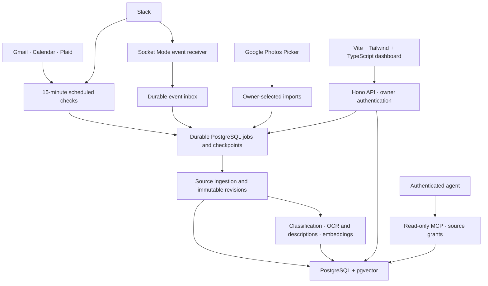

# Personal Context

Personal Context brings information from Gmail, Slack, Google Calendar, Capital One through Plaid, and owner-selected Google Photos into a searchable personal data service. Authenticated agents can retrieve relevant context and cite the evidence behind it through MCP. An owner dashboard manages connections and monitors the pipeline.

The central design choice is to separate source evidence, model interpretations, and agent access. An agent can use the context without gaining permission to send messages, change calendar events, move money, or mark tasks complete.

## Architecture



The Hono API serves owner controls and MCP. Independent workers ingest source data and process derived content. The Vite dashboard shows statistics, source freshness, job history, failures, and import progress; it is an operations interface rather than a personal-content inbox.

## Design choices

### PostgreSQL owns the data and the work queue

PostgreSQL stores canonical records, original payloads, revisions, relationships, typed source fields, selected image bytes, derived text, search chunks, and vectors. Full-text search and pgvector keep retrieval alongside the data it references. Model weights remain in the local model service.

Using one database lets a worker commit source records, its pagination checkpoint, and downstream jobs together. It also keeps backups and citation recovery in one place, without requiring a separate vector database, message broker, or media store for the MVP. The trade-off is that media, job history, and search compete for database resources. Downloads are bounded, and the dashboard exposes storage and processing backlog. See [database invariants and recovery](docs/database.md).

### Durable processing separates ingestion from inference

Jobs use deduplication keys, per-stream leases, heartbeats, bounded retries, and checkpointed pages. Replayed source items preserve their identity; stale workers cannot commit after losing their lease. Source ingestion, photo processing, and classification/indexing have separate worker lanes so slow local inference does not consume ingestion capacity.

A 15-minute check is a scheduling target, not a guarantee that upstream data is fresh or a backfill has finished. Check attempts, successful checks, provider watermarks, coverage gaps, and index progress are reported separately. This makes partial success visible instead of treating a connected account as fully synchronized.

### Each source has an explicit coverage model

| Source | Ingestion | Why this approach |
| --- | --- | --- |
| Gmail | Bounded backfill, then incremental history checks every 15 minutes | Preserve thread relationships and resume from durable cursors. |
| Slack | Socket Mode events plus 15-minute backfill/reconciliation | Events provide prompt changes; reconciliation recovers available history after gaps. Neither proves recovery of unavailable or retention-limited data. |
| Google Calendar | Calendar discovery and incremental event checks every 15 minutes | Preserve recurrence, cancellations, timezones, and all-day dates as distinct source semantics. |
| Capital One via Plaid | Incremental financial checks every 15 minutes | Preserve exact decimal amounts, removals, and pending-to-posted relationships; provider freshness can lag polling. |
| Google Photos | Explicit owner selection through Picker | Access is scoped to selected media rather than an unattended whole-library sync. Images receive metadata, OCR, and descriptions; videos have metadata-only coverage. |

Slack events are persisted with their processing job before acknowledgment. Event versions and deletion evidence prevent delayed events or old history pages from overwriting newer state. A reconnected socket does not automatically clear a coverage gap. Socket Mode also avoids a public event webhook. See [Slack](docs/slack.md), [Calendar](docs/calendar.md), [Photos](docs/photos.md), and [financial coverage](docs/capital-one.md).

### Source evidence stays separate from model interpretation

A source item has a stable record ID, while observed changes create immutable revisions. Chunks and derived artifacts identify the revision they describe. Ordinary search excludes superseded or deleted content; authorized historical citation lookup can still resolve earlier evidence.

Every content-bearing MCP result includes a stable internal URI, record and applicable revision/chunk IDs, source timestamps, ingestion time, and the original source link when available. Missing links or timestamps are explicit nulls. This gives an agent an exact citation even when the provider supplies no permanent URL.

Photo descriptions and other generated interpretations carry model/version provenance separately from original metadata. Source content is treated as untrusted data, including when it contains instructions directed at an agent.

### Labels overlap because relevance and urgency are different

| Label | Meaning |
| --- | --- |
| `personal` | Information received through the owner's action or in response to it, with explicit group-participation rules. |
| `background` | Routine context such as newsletters and promotions. |
| `blocking` | Another party appears to require an action or decision from the owner. |
| `update` | A notification or upcoming obligation. |
| `unorganized` | Classification exhausted its retries; an observable failure state, not an ordinary content category. |

A reply asking for a refund decision can be both `personal` and `blocking`. Group conversations qualify as personal through an explicit override, at least five owner messages in the preceding seven days, or an owner share of at least 10% in a nonempty seven-day window. Incomplete observed history is disclosed, and participation is reevaluated as activity ages out.

Blocking content supports evidence-backed tasks. Later source evidence can establish resolution; an elapsed deadline alone cannot. Classification records its rules/model version and evidence, and pending or stale work is distinguishable from failure. See [classification and task semantics](docs/classification.md).

### Retrieval combines semantic, keyword, and exact search

Semantic similarity helps with paraphrases, keyword search retains literal terms, and exact lookup handles known IDs and structured filters such as dates, participants, and transaction amounts. Hybrid queries combine keyword and vector candidates using reciprocal rank fusion, with bounded results and pagination.

Source grants, current revisions, deletion state, and exact filters apply before candidate ranking. Chunk IDs and source offsets preserve attribution. Embedding models have pinned versions and dimensions with separate vector indexes, preventing incompatible embeddings from being compared. Keyword and exact retrieval remain available when embeddings fail or are unconfigured, with incomplete semantic coverage reported explicitly. See [retrieval](docs/retrieval.md).

### MCP is read-only and scoped per agent

Each agent receives a bearer credential with explicit source-account grants. The five tools are `search_context`, `get_record`, `get_revision`, `list_blocking_tasks`, and `get_source_status`. There are no source actions, arbitrary SQL, synchronization controls, or task-completion operations in v1.

Retrieval uses a restricted database reader role and row-level source filtering. Grants and revocation are checked on requests, including direct citation lookup. A separate audit writer records tool access and returned record references without copying queries, source bodies, or credentials. Owner dashboard sessions are a separate authentication boundary, with CSRF protection for mutations and encrypted provider credentials. See [MCP](docs/mcp.md) and [authentication](docs/authentication.md).

### Local models keep inference under owner control

The native Ollama adapter supports local embeddings, structured classification/task extraction, and image description/OCR. The exercised local setup uses `embeddinggemma:latest` with 768 dimensions and `gemma3:4b` for classification and vision; installed model digests are pinned rather than trusting mutable tags. Outputs are validated before storage, including exact task evidence quotes and allowed task references.

A provider-neutral HTTP gateway is also supported. Model stages remain explicitly unconfigured until selected; no external inference provider is chosen implicitly. Local inference trades throughput and hardware capacity for control over where personal content is processed. See [model setup and adapter contracts](docs/local-models.md).

## Run locally

Use Node.js 24, npm 11, and a running Docker installation. Run commands from the repository root.

### 1. Install and prepare PostgreSQL

Copy `.env.example` to `.env` if you do not already have one; preserve existing credentials when updating an installation.

```sh
npm ci
# First setup only:
cp .env.example .env
npm run db:up
npm run db:check
npm run db:migrate
```

The Compose database uses PostgreSQL with pgvector on loopback port 55439. Its credentials are for development only. `db:up` waits for readiness; existing volumes are retained. Run migrations after pulling schema changes. `npm run db:stop` stops the database while preserving its named volume.

### 2. Configure owner access and providers

Generate a 32-byte base64 `CREDENTIAL_ENCRYPTION_KEY`, store it privately in `.env`, and retain it with your recovery material. Then choose an owner password through the interactive prompts:

```sh
node -e "console.log(require('node:crypto').randomBytes(32).toString('base64'))"
npm run owner:setup
```

Configure provider credentials in `.env` before connecting accounts in the dashboard. Follow [authentication and Google OAuth setup](docs/authentication.md), [Slack setup](docs/slack.md), [Photos selection](docs/photos.md), and [Plaid setup](docs/capital-one.md). Google callbacks use `${APP_ORIGIN}/api/connections/{gmail|calendar|google-photos}/callback`. Local Slack uses the HTTPS callback bridge described below. Never put provider secrets in browser configuration.

### 3. Configure models

For the exercised macOS/Ollama setup:

```sh
brew install ollama
brew services start ollama
ollama pull embeddinggemma
ollama pull gemma3:4b
npm run models:setup
```

Keep Ollama bound to loopback and configure `disable_ollama_cloud: true` in `~/.ollama/server.json` for local-only execution. The setup command checks installed models with synthetic inputs, discovers digests and vector dimensions, and writes model settings only after validation succeeds. Other environments can run Ollama separately or implement the HTTP gateway contract. See [local models](docs/local-models.md) for configuration, timeouts, and alternatives.

Defaults are a 20 MiB per-media download limit, 30-day historical backfill, and 90-day future calendar coverage. Override `MAX_MEDIA_BYTES`, `BACKFILL_DAYS`, and `CALENDAR_FUTURE_DAYS` as needed. These are requested coverage bounds, not completed-import guarantees.

### 4. Start the services

Run each command in a separate terminal:

```sh
npm run dev:api
npm run dev:web
npm run dev:worker
```

Open [the dashboard](http://127.0.0.1:5173), sign in, and connect your sources. The API defaults to port 3000; set `API_PORT` in `.env` if that port is occupied. Vite reads that setting for its proxy. Restart affected services after environment changes. `/health` provides liveness only; operational endpoints require owner authentication.

For Slack OAuth on the local HTTP dashboard, prepare and run the HTTPS bridge:

```sh
npm run slack:https:setup
npm run dev:slack-callback
```

Restart the API after setup writes `SLACK_REDIRECT_URI`. Register `https://127.0.0.1:5443/api/connections/slack/callback` in the Slack app, visit that origin once to accept the local development certificate, then connect through the dashboard. The helper does not change system certificate trust.

For Slack events, enable Socket Mode and user message subscriptions, save the app-level token through the dashboard, and run:

```sh
npm run worker:slack
```

The default worker already processes the event inbox and scheduled reconciliation. The older `worker:slack-process` command is an alternative Slack-only processor, not an additional required service. Photos imports start through **Choose photos** in connection settings.

### 5. Connect an agent

Use **Agent Access** in the dashboard to create a credential with selected source grants. Configure an MCP client to connect to `http://127.0.0.1:5173/mcp` with its bearer header. The credential is shown once. See [MCP client configuration and tools](docs/mcp.md) for the request format and citation workflow.

## Verification and current limits

```sh
npm run typecheck
npm test
npm run test:db:isolated
npm run build
# First browser-test setup only:
npx playwright install chromium
npm run test:ui
```

Database integration checks create temporary databases; browser checks mock provider/API responses. Neither substitutes for authorized live provider checks. [Verification notes](docs/verification.md) distinguish fixture results, local model checks, real source ingestion, and remaining acceptance gaps. The implementation checklist is [tracked in OpenSpec](openspec/changes/personal-context-mvp/tasks.md).

Owner-authorized Gmail, Calendar, Slack Web API, and selected Photos ingestion have been exercised, alongside local model and MCP checks. Backfill and derived indexing can remain incomplete. Slack live event delivery/reconnect acceptance and Capital One production feasibility remain open; Plaid Sandbox results do not establish production bank access. No production deployment is claimed.

For operating beyond local development, see [operations](docs/operations.md), [backup and restore](docs/backup-restore.md), and [deployment](docs/deployment.md). Deployment still requires an appropriate HTTPS origin, secrets management, database role configuration, and verified source access.
